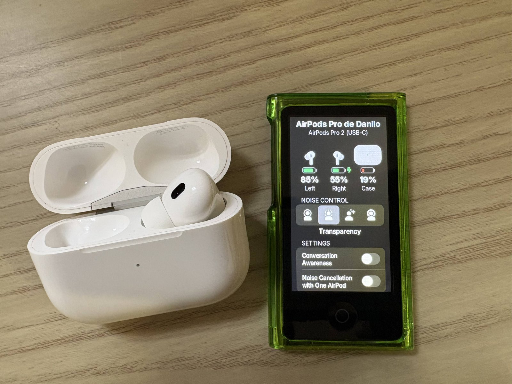
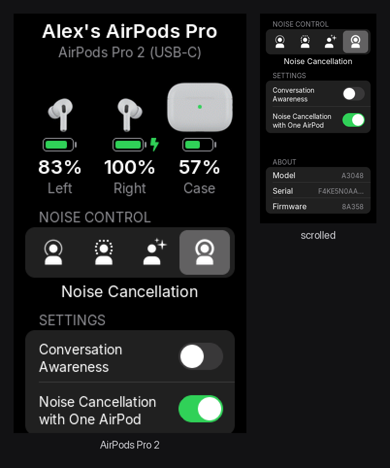
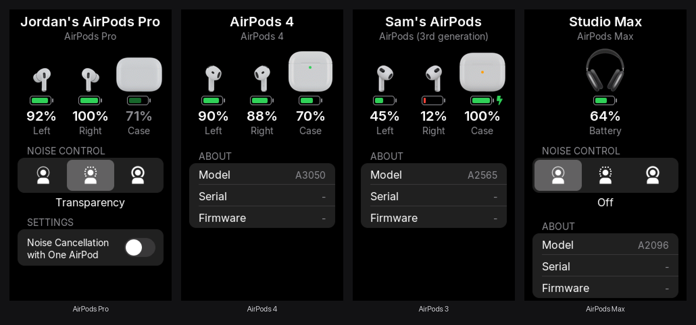
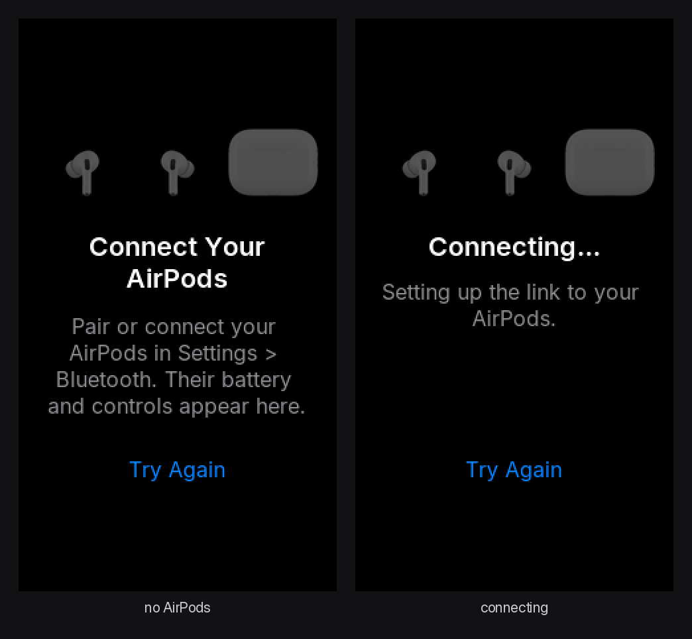

<p align="center">
  
</p>

# n7airpods

**AirPods controls for the iPod nano 7th generation.** Battery for each bud and the case, listening modes,
Conversation Awareness and more, in an iOS-style page on a 2012 iPod nano.


It is an app for [NanoApps](https://github.com/nfzerox/NanoApps), plus a few resident modules that speak Apple's
AirPods control protocol (AAP) over the nano's own Bluetooth. Nothing runs on the AirPods and nothing is needed
from an iPhone.

> **Experimental.** This patches the nano's Bluetooth handling at run time and replaces NanoApps' resident. It has
> been tested on one iPod nano and one pair of AirPods, and during development it crashed the nano more than once
> before the design settled. Read [Install](#install) before you start. This project is not affiliated with Apple.

## What it does

<p align="center"></p>

- **Battery** for the left bud, the right bud and the case, with charging bolts. The case level comes from the
  AirPods' Bluetooth advertisements; the last known level is dimmed when it is stale.
- **Noise control**: Off, Transparency, Adaptive and Noise Cancellation, for the models that have them. The page
  follows changes made on the buds too (a stem squeeze moves the highlight).
- **Settings**: Conversation Awareness and Noise Cancellation with One AirPod, for the models that have them.
- **About**: model, serial number and firmware, read from the AirPods.
- **Only what your AirPods can do**: the page shows the rows the connected model supports, with the right
  pictures for each generation.
- **Feels native**: Inter typeface, iOS-dark colours, animated selection and switches, and scrolling at roughly
  50-60 fps (details in [docs/ARCHITECTURE.md](docs/ARCHITECTURE.md#making-the-page-fast)).

<details>
<summary>More screenshots (other models, states)</summary>


<br><br>


These are renders of the real page code with mock data (`tools/ui_preview`), not photos.
</details>

## Compatibility

| | |
|---|---|
| iPod | iPod nano 7th generation, firmware 1.1.2, running [NanoApps](https://github.com/nfzerox/NanoApps) |
| Computer for the install | macOS (tested) or Linux (whatever NanoApps' own installer supports) |
| AirPods, **tested** | AirPods Pro 2 (USB-C) |
| AirPods, supported on paper | AirPods 1, 2, 3, 4 (and 4 with ANC), Pro, Pro 2, Pro 3, Max, Max (USB-C) |

"On paper" means the page knows what each model can do (from published protocol documentation) but I have only
been able to try one. The page is built to fall back to the basics (batteries) for anything it does not
recognise, rather than offer controls that might not exist. If you try another model, please open an issue and
say how it went.

## Install

You need an iPod nano 7G that already runs NanoApps (follow
[its README](https://github.com/nfzerox/NanoApps#download-and-install-nanoapps) first), and AirPods paired with the
nano in its Bluetooth settings.

```sh
git clone https://github.com/danfragoso/n7airpods.git
cd n7airpods
./install.sh --build-only     # optional first run: builds everything, writes nothing to the iPod
./install.sh                  # builds, then installs the resident (the iPod restarts), then the app
```

`install.sh` downloads NanoApps at the exact commit this project was made against, applies
[a small patch](integration/nanoapps-aap.patch), adds the resident modules and the app, and builds with NanoApps'
own `./start`. The first run is slow: NanoApps installs missing build tools and compiles LVGL from scratch.
Keep the iPod connected by USB until it says **Done**, then unplug it.

What it changes on the iPod: it replaces NanoApps' **resident** (the program NanoApps keeps loaded) with a patched
one, and adds `Apps/AirPods.nanoapp`. NanoApps keeps a backup of what it replaces in
`.nanoapps/build/install-backups`.

Options: `--nanoapps DIR` (use another NanoApps checkout), `--no-apple-art` (leave out Apple's pictures, see
[docs/ASSETS.md](docs/ASSETS.md)), `--yes` (do not ask before writing to the iPod).

### Prebuilt files

Each [release](../../releases) has `n7airpods-<version>-prebuilt.zip` with `Apps/AirPods.nanoapp` and
`Library/resident.hbapp` (the same layout as NanoApps' own disk ZIP) and a `SHA256SUMS` file. They are built from the
tagged source by the same recipe as `install.sh`. **`install.sh` is the tested way to install.** Copying the two
files onto the iPod by hand follows how NanoApps documents adding apps, but I have not tried replacing the
resident that way: NanoApps' installer replaces it, restarts the iPod and checks the version, and a plain file copy
may not take effect.

### Updating and removing

- **Update**: `git pull`, then `./install.sh` again.
- **Remove the app**: delete `Apps/AirPods.nanoapp` from the iPod's disk.
- **Put NanoApps' own resident back**: `./install.sh --restore-stock` (the same installer path, from an unpatched
  checkout). The AirPods app then shows "Resident update needed" until you install it again.

## Using it

1. Pair your AirPods with the nano (Settings, Bluetooth) and connect them as you would for music.
2. Open **AirPods** on the Home screen.
3. After a moment the page appears. Tap a noise-control mode; flip a switch; scroll down for About.

If the AirPods are not connected the page says **Connect Your AirPods**. If the link is up but the control channel
is not, it says **Connecting...** and offers **Try Again**.

Plugging the nano into a computer switches its Bluetooth off (it enters disk mode), so the AirPods disconnect.
Unplug, and they reconnect.

## Troubleshooting

| What you see | What to do |
|---|---|
| "Connect Your AirPods" although they are connected | The page needs the normal audio link first. Check Bluetooth settings, put the AirPods in and reconnect, then tap **Try Again**. |
| "Connecting..." does not go away | Tap **Try Again**. After three failed attempts the resident waits until the link changes or you retry. Taking the AirPods out and in again, or reconnecting, restarts it. |
| "Resident update needed" | The app is installed but the resident is not the patched one. Run `./install.sh` again. |
| A switch snaps back with "Could not reach the AirPods" | The change could not be sent. Wait for the connection and try again. |
| The switches do not reflect a change you made on your iPhone | The AirPods only announce their settings when they connect; nothing tells the nano about later changes. Reconnect to refresh. |
| Case battery is dimmed or shows "-" | The case only advertises while its lid is open or it is charging; the page keeps the last level it saw. |
| `install.sh`: "no iPod found" | Connect the iPod, wake it, and use a direct USB port. For "Input/output error" see NanoApps' README (`./start fsck`). |
| Something else | Read the device's log: in `.nanoapps`, run `./start trace 200`. The Bluetooth flight recorder is read with `python3 tools/btlog.py` (see [tools/README.md](tools/README.md)). Open an issue with what you see. |

For debugging, the resident looks for two optional marker files at the path `/Apps/Data/` on the iPod:
`btlog.off` turns the Bluetooth flight recorder off, and `did.on` turns on a Device-ID experiment that is off by
default ([docs/ARCHITECTURE.md](docs/ARCHITECTURE.md#safety-rules-the-code-follows)). I have not exercised either
switch on a device.

## Build, test, hack

```sh
./install.sh --build-only          # patched NanoApps checkout in .nanoapps, app + resident built
tools/run_host_tests.sh            # AES and BLE parser unit tests, no iPod needed
tools/ui_preview/                  # render the page on the desktop (see tools/README.md)
```

| Folder | |
|---|---|
| `app/aap_ctl/` | the app: the page (`aap_ui.c`), the model table, generated icons, fonts and pictures |
| `integration/` | the resident modules and the NanoApps patch ([README](integration/README.md)) |
| `docs/` | [how it works](docs/ARCHITECTURE.md), [the AAP protocol notes](docs/PROTOCOL.md), [artwork](docs/ASSETS.md), and the [research log](docs/research/README.md) |
| `tools/` | tests, the desktop preview, asset generators, the flight-recorder reader |
| `research/` | the reverse-engineering phase: firmware scripts and early probes. Historical, and some of it crashed the iPod |

## Ideas

Not promises, in the order I would do them: an Adaptive noise level slider; live in-ear status for each bud;
more settings (Personalized Volume, volume swipe, tone volume, press speed and hold duration, sleep detection);
pausing music when a bud comes out. Not planned: renaming the AirPods and the hearing-aid features, which need
an enrollment from an iPhone.

## Credits

- [NanoApps](https://github.com/nfzerox/NanoApps) by nfzerox and contributors: the platform that makes this
  possible. Its own thanks go to nano7-untethered, andrew867's NanoApps, NanoBtFix (Merquice), nano7-a1717-dock,
  nano7kit (Shimku) and ipod_sun (ninjaprawn); NanoBtFix's work on this device's Bluetooth was the foundation.
- [LibrePods](https://github.com/kavishdevar/librepods) by kavishdevar: its documentation of the AirPods protocol
  made this possible. No code was copied.
- [blueth4w](https://github.com/kilo2071/blueth4w) (kilo2071) showed the nano's Bluetooth stack could be understood;
  [wInd3x](https://github.com/freemyipod/wInd3x) (freemyipod) made the firmware readable.
- [Inter](https://github.com/rsms/inter) typeface, [LVGL](https://github.com/lvgl/lvgl).

## License

MIT, see [LICENSE](LICENSE). Apple's artwork and third-party components have their own terms, see
[NOTICE.md](NOTICE.md). Apple, AirPods and iPod are trademarks of Apple Inc.
